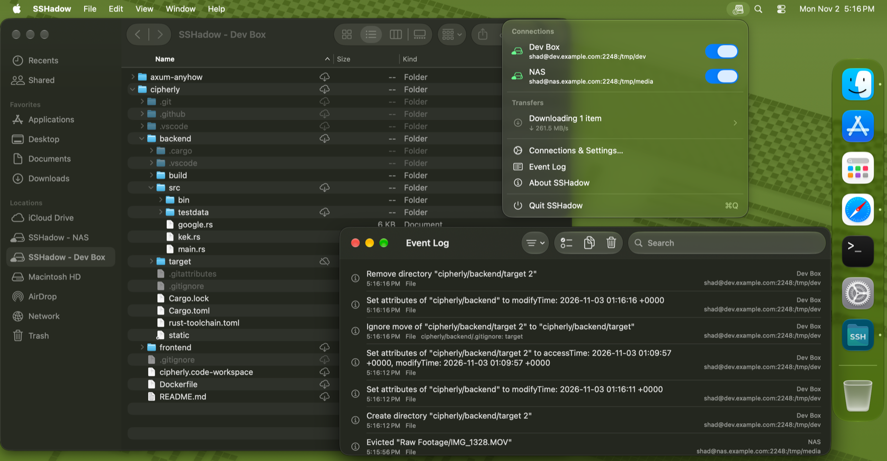

# SSHadow

A macOS menu bar app that mounts remote directories over SSH in Finder.

SSHadow uses the File Provider framework, so each connection shows up as a location in Finder's sidebar. Files are listed and downloaded on demand rather than synced up front, and edits are uploaded back to the server.

## Features

- Multiple connections, each mapping a remote path on an SSH server to a Finder location.
- Password and private key (with optional passphrase) authentication.
- Credentials stored in the macOS Keychain.
- Server host keys are trusted on first connect, and a changed key blocks the connection until you review it.
- Automatic reconnects with exponential backoff when a connection drops.
- Connections can be paused and resumed without removing them from Finder.
- Browse remote tree without pulling all of it.
- Stream file contents with read-ahead caching for sequential reads.
- Downloaded files can be removed to free up local space while staying listed in Finder.
- Edits are uploaded back to the server.
- When a file changes on both sides, your Mac's copy wins and the server's copy is moved to `.sshadow/trash` on the server.
- Periodic polling picks up remote changes so Finder stays in sync with the server, on a schedule you can set globally or per connection.
- Ignore files (`.sshadowignore` by default, configurable per connection) keep matching items from being uploaded or downloaded.
- Fast uploads and downloads, with a transfer progress summary in the menu bar.
- An event log of every remote change and conflict, kept across relaunches, with search and filters.
- Optional Open at Login.

## Architecture

- Built on our own SSH client, [SwiftRussh](https://github.com/kosolabs/swift-russh), a Swift wrapper around the Rust [russh](https://github.com/Eugeny/russh) library, for much faster uploads and downloads than other pure Swift SSH implementations.
- Runs inside the macOS App Sandbox, with the following entitlements:
  - Outgoing network access to reach SSH servers.
  - Shared app group between the app and its File Provider extension
  - Security-scoped bookmarks for accessing user-selected files (like private keys) outside the sandbox.

## Requirements

- macOS 15.0 or later
- An SSH server with SFTP enabled

## License

See [LICENSE](LICENSE).
